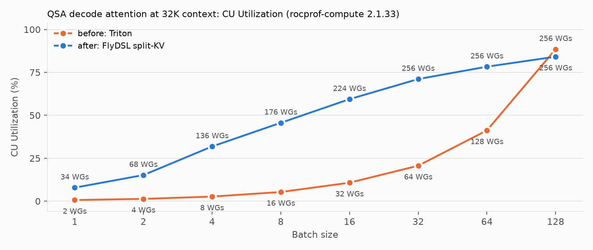
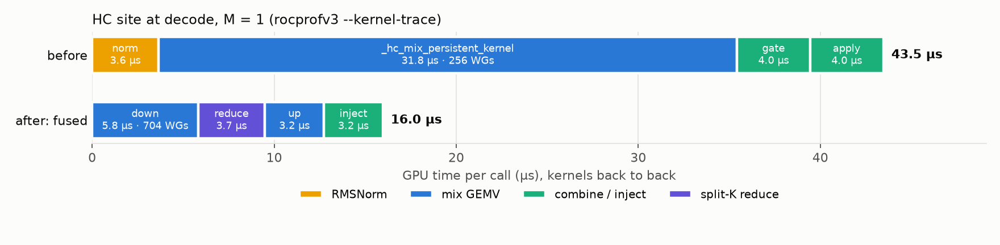
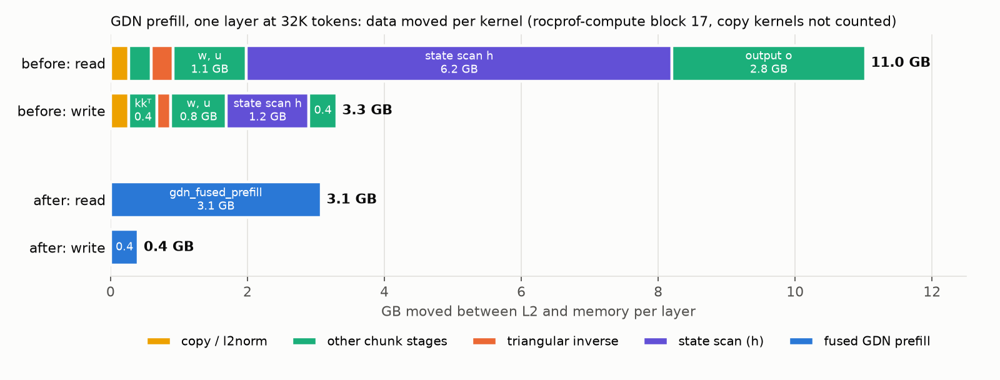

Qwen3.8-Flash-Next is an efficient, open-weight MoE model, previewing the next-generation Qwen4 architecture. It has gained significant attention in the open-source community due to its strong coding and agentic capabilities, ultra-sparse architecture, and innovations such as Gated DeltaNet (GDN) and Qwen Sparse Attention (QSA) for efficient long-context inference. Given these strengths, enabling and optimizing Qwen3.8-Flash-Next inference on AMD Instinct MI355X GPUs is important. In this blog, we demonstrate how to improve its inference performance through a series of optimizations in SGLang on AMD GPUs. We benchmark inference performance using the InferenceX AgentX benchmark, which replays realistic multi-turn agentic coding workloads and measures throughput and interactivity across different concurrency levels. Our optimized MI355X implementation outperforms NVIDIA B200 and B300 GPUs across all tested concurrency levels.

This post explores how we serve and optimize Qwen3.8-Flash-Next on AMD Instinct MI355X GPUs using SGLang. We begin with our latest InferenceX AgentX benchmark results, followed by a brief introduction of the model architecture, key kernel optimizations for MI355X, including grid sizing for 256 CUs, kernel fusion, MFMA-native layouts, register prefetching, and wave64, and the monokernel for low concurrency. All results can be reproduced using the commands provided in the [SGLang cookbook](https://lmsysorg.mintlify.app/cookbook/autoregressive/Qwen/Qwen3.8-Flash-Next#hw=mi355x&variant=default&quant=fp8&strategy=balanced&nodes=single&pleOffload=auto).

## Performance

We use InferenceX AgentX to evaluate inference performance, as InferenceX is a public benchmarking platform that enables fair comparisons across different hardware platforms using standardized workloads and configurations. AgentX provides realistic multi-turn agentic coding workloads that capture long-context requests, prefix caching, and subagent interactions. Its throughput and interactivity metrics allow us to assess serving performance across different concurrency levels, reflecting real-world agentic workloads.

As shown in Figure 1., we ran Qwen3.8-Flash-Next on one MI355X at concurrency 1, 2, 12, 24, 48 and 80 on the SGLang ROCm image lmsysorg/sglang-rocm:v0.5.23-rocm10-mi35x-20261117. Each point replays recorded coding-agent sessions from the InferenceX AgentX trace set for 3,600 s. Throughput per GPU rises from 16.8k to 230.8k tok/s as concurrency grows, while per-user interactivity falls from ~390 to ~27 tok/s/user. At low concurrency the monokernel drives interactivity; at high concurrency kernel fusion and HiCache keep throughput scaling.


*Figure 1. Total throughput per GPU against interactivity across concurrency 1–80.*

At high concurrency (24–80), the workload is dominated by long, largely shared prompts, so prefill speed and cache capacity matter as much as decode speed. Our MI355X run reaches about 126k tokens/s per chip at conc=24 and about 231k at conc=80, matching or exceeding B300 at the same P90 interactivity and staying well above B200 and our previous MI355X results. All of it runs on the public SGLang ROCm image. At low concurrency (1–2), decoding is bound by kernel launches, not arithmetic: one decode step took about 14 ms across more than 1,600 small kernels. Our monokernel, a persistent FlyDSL kernel that runs a full MTP verify step in 13 launches, cuts that to about 4 ms. P90 interactivity reaches about 390 tokens/s/user at one agent, where B300's curve falls off to a few thousand tokens/s per chip. We will give more details about the optimizations in the latter sections.

**NOTE:** Until the day Nov 19, 2026, we wrote the blog and the performance submission shown in the figure depended on 7 PRs that awaited to be merged to the SGLang main branch.

## Qwen3.8-Flash-Next Model Architecture

The model architecture of Qwen3.8-Flash-Next is shown in Figure 2. For its inference, these properties of the model architecture matter:

- **Gated Delta Net.** 36 of the 48 layers use Gated Delta Net, a linear-attention layer with a fixed-size recurrent state per request, so its decode cost does not grow with context.
- **Query Sparse Attention.** The other 12 use Query Sparse Attention: each query attends to a learned selection of past positions, with 24 query heads sharing 2 KV heads of dimension 256.
- **Hyper-connections.** Instead of one residual stream, the model keeps 4 streams of width 2,560. Before every block a gated mix collapses them into one input. It is small but runs in every layer at every step.
- **Native MTP.** A built-in draft layer proposes tokens for speculative decoding, verified by the target in one forward pass.


*Figure 2: Qwen3.8-Flash-Next model architecture*

### The checkpoint: MXFP4 experts with AMD Quark

For AMD Instinct GPUs, we quantized the Qwen3.8-Flash-Next model weights using AMD Quark, a model optimization toolkit that supports post-training quantization for efficient inference on AMD hardware. The resulting quantized model reduces GPU memory consumption and improves inference efficiency. In our experiments, we serve `[amd/Qwen3.8-Flash-Next-Quark-MXFP4-AttnFP8-PLEFP8](https://huggingface.co/amd/Qwen3.8-Flash-Next-Quark-MXFP4-AttnFP8-PLEFP8)`.

The quantized checkpoint occupies approximately 116 GB, fitting comfortably on a single AMD Instinct MI355X GPU (288 GB HBM3E) while leaving enough memory for a large KV cache, enabling higher concurrency and more efficient inference serving. The MTP draft model is quantized using the same approach as the target model, allowing its MoE layers to benefit from the same optimized MXFP4 kernels.

## Kernel Optimization

## Where the kernels sit in Qwen3.8-Flash-Next

Qwen3.8-Flash-Next is a hybrid model with 48 layers:

- **36 GDN layers** (Gated DeltaNet linear attention) keep a fixed-size state
  instead of a KV cache. Prefill runs a chunked scan over 64-token chunks.
- **12 QSA layers** (Qwen sparse attention, every fourth layer). An indexer
  picks 512 compressed blocks of 4 tokens plus up to 3 recent tokens, so
  each query attends to only 2,051 positions.
- **Hyper-connections (HC).** The model keeps four residual streams. Around
  every attention and MLP block, an HC site mixes the streams into the block
  input and injects the block output back.

All numbers below are for one MI355X at TP1, with the MXFP4 checkpoint and MTP.
These are the shapes the kernels see:

| Kernel | Shapes at TP1 | What limited it on MI355X |
|---|---|---|
| QSA sparse decode | 24 query heads, 2 KV heads (GQA group 12), head dim 256, top-k 2051 | Grid of rows × 2 KV heads, plus an extra gather pass |
| GDN chunked prefill | 48 value heads, 16 key heads, K = V = 128, 64-token chunks | 8 launches per layer, per-chunk state round trip through HBM |
| HC site, decode | 4 streams × 2560 = K 10240, low rank R 320, M ≤ 128 rows | Norm, mix, inject GEMV and combine as separate small kernels |


## 1. Kernel shape: QSA sparse decode did not fit the GPU

MI355X has **256 CUs**, and a kernel is fast only if every CU has work. At
decode, each row is one query token: 24 query heads (12 per KV head, GQA)
attend to 2,051 selected positions of their KV head. So the kernel has three
dimensions: **rows** (1–128), **KV heads** (2) and **positions** (2,051).

### Before: a prefill kernel reused for decode

ROCm ran the Triton *prefill* kernel `_sparse_gqa_chunk_prefill` with a query
length of 1. At batch 8:

| Level | Before (Triton) |
|---|---|
| Grid | rows × KV heads = **16 workgroups** |
| Workgroup | **8 waves** |
| Tile | **16 rows × 32 tokens** (12 GQA heads padded to 16) |
| Loop | **65 steps** of 32 positions per workgroup |

Three problems:

1. **The grid follows the problem, not the GPU.** 16 of 256 CUs work at
   batch 8, and 2 at batch 1. Only 2 KV heads makes it worse.
2. **The only large dimension is a loop.** Each workgroup walks all 2,051
   positions, so the kernel takes 65 steps whatever the batch.
3. **The tile was sized for another GPU.** A 16-row tile is one MFMA tile, so
   the 8 waves cannot split it: all of them compute the same scores (the same
   mistake as in part 2).

### After: split-KV, grid computed from the CU count

The FlyDSL kernel cuts each row's positions into `num_splits` pieces, one
workgroup each. Each workgroup writes a partial result (`O`, max `m`, sum
`l`), and a small reduce kernel merges them as online softmax does.

| Level | After (FlyDSL), batch 8 |
|---|---|
| Grid | rows × KV heads × `num_splits` = 8 × 2 × 11 = **176 workgroups** |
| Workgroup | **4 waves** |
| Tile | per wave **16 tokens × 16 heads**, one 16 × 16 × 32 MFMA tile |
| Loop | 192 positions per split = **3 rounds** of 4 waves × 16 tokens |

Tokens now sit on the 16-row side of the tile, so each wave has its own work.
`num_splits` is chosen at run time: aim for one workgroup per CU, keep at
least 128 positions per split (below that, workgroup startup dominates), and
round to whole 64-position rounds. It depends only on the batch size, so it is
fixed per captured CUDA graph.


At batch 8: 16 workgroups, 128 wavefronts and **5.4% CU Utilization** before;
176 workgroups, 704 wavefronts and **46.6%** after.



Before, CU utilization follows the workgroup count and reaches the full GPU
only at batch 128. After, it is 46% at batch 8 and over 70% from batch 32. At
batch 1 it stays at 8%: the 128-position minimum caps the grid at 34
workgroups.

At batch 128 nothing is split and the reduce is skipped, but the new kernel is
still 1.4× faster: no duplicated waves, and it reads K/V straight from the
cache pool instead of from a gathered copy.

**Takeaway:** compute the grid from the CU count, move part of the long loop
into the grid, and size waves and tiles for MFMA. Check **Grid Size** and
**CU Utilization** at the batch sizes you actually serve, not only the largest.

## 2. MMA: the HC mix issued 4.5× too many MFMAs

The HC site mixes four residual streams (10,240 values per row) with two
GEMVs: **down** to 320 values and **up** back to 10,240. At batch 1 that is
about 13 MB of weights and almost no math, with the single row padded to a
16-row MFMA tile. On ROCm both GEMVs ran in one persistent Triton kernel,
`_hc_mix_persistent_kernel`, with **8 waves**.

### Why the old kernel issued so many MFMAs

Triton gives each wave 16 × 16 output tiles of a `tl.dot` and does not split
`k`, so extra waves compute copies. One wave count served both GEMVs:

```
up GEMV    16 rows × 128 per step = 8 MFMA tiles   → 8 waves, 8 different tiles   ✓
down GEMV  16 rows × 32  per tile = 2 MFMA tiles   → every wave computes both     8 copies ✗
```

The down GEMV issues 51,200 MFMAs instead of 6,400. With the up GEMV, that is
**57,600 MFMAs where 12,800 are needed**, exactly what rocprof-compute reports:

The matrix cores are not the bottleneck (MFMA utilization stays under 1%; a
batch-1 GEMV is memory-bound). The copies cost waves: each one reads its tile
back from LDS (most of the 136,703 LDS instructions), 95% of the 120 M
wave-cycles are spent waiting, and the weights arrive at **430 GB/s** on a GPU
with 8 TB/s.

### How we reduced it

- **One kernel per GEMV, each with its own wave shape.** Down: 704 one-wave
  workgroups (22 row tiles × 32 splits of `k`) plus a small reduce kernel. Up:
  640 waves, one 16-column tile each.
- **Weights packed in MFMA fragment order** at load time (1 KB per 16 × 32
  fragment). One 16-byte load per lane *is* the MFMA operand, straight from
  HBM to registers, with no LDS in the down GEMV.
- **The rest of the site rides along.** The RMSNorm is folded into the packed
  weights and the reduce; the inject GEMV becomes one more row tile of the
  down GEMV.

### Result

| per HC site, batch 1 | Before | After (down + up) |
|---|---:|---:|
| MFMA instructions | 57,600 | **13,120** (12,800 + 320 for the inject GEMV) |
| LDS instructions | 136,703 | **0** + 9,280 |
| Wave cycles | 120 M | **9.9 M** |
| Weight read bandwidth | 0.43 TB/s | **1.6–1.8 TB/s** |



The site drops from 43.5 to **16.0 µs** at batch 1 (still 4 kernels: the mix
became three small ones, the separate norm and inject are gone). The PR
measures 3.0× per site at M = 1 down to 1.4× at M = 128, and **+14.9% P90
interactivity, +5.6% throughput** end to end.

**Takeaway:** a matrix product keeps busy only as many waves as it has 16 × 16
output tiles. Size the waves per product, and split `k` across workgroups when
there is only one tile. In rocprof, an MFMA count that is a multiple of the
needed one means the waves compute copies.

## 3. Memory: GDN prefill moved its intermediates through HBM

A GDN layer keeps a 128 × 128 state per value head. In prefill, tokens are cut
into chunks of 64 (512 chunks at 32K), and for every chunk and head:

```
1. normalize q, k
2. A    = masked, decayed β·k·kᵀ                     64 × 64
3. T    = (I + A)⁻¹                                  64 × 64
4. w, u = from T, k, v                               64 × 128
5. S    = new state from the old S, w, u, k          128 × 128   ◄── needs the previous chunk
6. o    = output from q, k, S, u                     64 × 128
```

Only the inputs and the output o must touch HBM: about 0.7 GB read and 0.4 GB
written per layer at 32K tokens.

### Before: one kernel per stage

The Triton path runs 9 kernels per layer, one per stage. Each writes its whole
result to HBM and the next reads it back. The worst is the state scan (step
5): it writes the state of **every** chunk so the output kernel can read them,
runs on only 384 workgroups, and every kernel starts cold with little work to
hide HBM latency.

| Kernel | Step | Time | Read | Written |
|---|---|---:|---:|---:|
| l2norm (× 2) | 1 | 2 × 0.04 ms | 0.3 GB | 0.3 GB |
| kkᵀ | 2 | 0.17 ms | 0.3 GB | 0.4 GB |
| inverse | 3 | 0.50 ms | 0.3 GB | 0.2 GB |
| w, u | 4 | 0.37 ms | 1.1 GB | 0.8 GB |
| state scan h | 5 | 1.34 ms | 6.2 GB | 1.2 GB |
| output o | 6 | 0.47 ms | 2.8 GB | 0.4 GB |
| **total** | | | **11.0 GB** | **3.3 GB** |

(rocprof-compute block 17; the two copy kernels are not counted.)

### After: one kernel, intermediates on chip

- **192 workgroups of 8 waves**, each owning one head and a 32-column slice of
  its state, walking the chunks in order.
- **State in registers**, written to HBM once at the end. `A`, `T`, `w`, `u`
  stay in registers and LDS; per chunk only o is written.
- **Prefetch two chunks ahead**, so the loads hide behind compute.
- **No masks at the sequence end**: the output buffer descriptor ends there,
  and the hardware drops stores past it.

```
before:  q,k ─► [l2norm] ─HBM─► [kkᵀ] ─HBM─► [inverse] ─HBM─► [w,u] ─HBM─► [state scan] ─HBM─► [output] ─► o
after:   q,k,v ─► [ one kernel: steps 1–6 on chip, state in registers, prefetch ] ─► o, final state
```

### rocprof: before and after



Traffic falls from **14.3 GB** to **3.5 GB** per layer. The fused kernel
writes **0.4 GB, exactly the output o**: nothing else leaves the chip. Its
3.1 GB of reads are above the 0.7 GB minimum because every workgroup that
needs q and k reads them again.

**Takeaway:** count bytes, not only FLOPs. When stages share a serial loop, as
GDN's chunks do, fuse them, keep state and intermediates on chip, and load
ahead. In rocprof-compute, L2-Fabric bandwidth × kernel time should be close to
what the math needs; writes in particular should match the output size.

### Monokernel

When we first benchmarked this model on AMD MI355X we quickly realized that the low concurrency region (i.e., <= 8) was going to be the most critical for us in terms of performance.


*Figure 3: Kernel trace of a full decode step at concurrency 1 without monokernel*

Figure 3 shows the full trace of one decode step at concurrency 1. As you can see, it takes roughly 14ms for a total of over **1600 individual kernel launches**.
Launching a lot of kernels is not necessarily a problem as HIP graphs can get rid of kernel launch overheads but in this case it actually is. The issues is that these kernels are all very small so the GPU is not doing useful work but mostly loading data from and to HBM memory. In this scenario, the most practical optimization strategy is simply trying to reduce as much as possible the HBM traffic, this means fusing multiple operations together.

In order to achieve the best possible performance at low concurrency, we decided to fuse as many kernels as possible into a single (mono) kernel.
As we saw in figure 2, the basic building block for Qwen3.8-Flash-Next is 3x GDN layers followed by a QSA layer, repeated 12 times for a total of 48 hidden layers. We implemented a specialized FlyDSL kernel that replaces this basic building block with a **single kernel launch**.


*Figure 4: Kernel trace of a full decode step at concurrency 1 with the new FlyDSL monokernel*

Figure 4 shows a full decode step with the monokernel on. With this we got rid of over 1600 kernel launches and replaced them with just **13** and went from almost **14ms to 4ms**, that's over **3x improvement** in decode speed.

For more details, the monokernel source code is available on [GitHub](https://github.com/sgl-project/sgl-amd-mono/tree/main/sgl_amd_mono/qwen38_flash_next).

## Conclusion

With a Quark MXFP4 checkpoint that fits on a single MI355X and a set of MI355X-specific kernels in SGLang, Qwen3.8-Flash-Next reaches about 231k tokens/s per GPU at concurrency 80 and about 390 tokens/s/user at concurrency 1 on InferenceX AgentX, matching or exceeding B300 and staying well above B200 across the range we tested. Two kinds of change made the difference. Rewriting the NVIDIA-oriented kernels around the MI355X (a grid sized for 256 CUs, MFMA-native layouts, and intermediates kept on chip) improves the high-concurrency regime. At low concurrency, the FlyDSL monokernel replaces more than 1,600 launches per decode step with 13 and cuts the step from about 14 ms to 4 ms. The kernel changes are pull requests to SGLang and AITER, and the monokernel is open source in `sgl-amd-mono`, so you can reproduce the results with the SGLang cookbook and try them on your own workloads.

## Acknowledgements

We thank the Qwen team, the SGLang community, and the AMD AITER, FlyDSL, Quark, ROCm and InferenceX contributors whose work this post builds on. [TODO: names.]

## Test configuration and disclaimer

**Software stack of the recipes above:** `lmsysorg/sglang-rocm:v0.5.23-rocm10-mi35x-20261117` (SGLang `c67db7c762`, AITER `581579ab`, FlyDSL 0.4.2), patched with the open PRs listed above. **Numbers in Performance and Accuracy** were measured on one GPU of an 8x AMD Instinct MI355X node in October 2026 with `lmsysorg/sglang-rocm:v0.5.22-rocm10-mi35x-20261026` (SGLang `5ef99013`, AITER `285579b6`), patched with the PRs open at the time, through the InferenceX AgentX agentic-coding harness (AIPerf replay of recorded coding-agent traces, 3,600 s per point, InferenceX run [40420614823](https://github.com/SemiAnalysisAI/InferenceX/actions/runs/40420614823)). Per-PR numbers quoted in the optimization sections come from each pull request's own benchmarks, on the base and image given there. Speculative-decoding throughput uses InferenceX's committed synthetic acceptance length; accuracy uses lm-eval with real verification. Results on other hardware, software versions, settings or workloads will differ; these figures are for illustration and are not a performance guarantee.

#### Article by

Authors: Nikolai (@amd-nprotaso), Christian Gilli (@amd-cgilli), and Chang Liu (@ChangLiu0709) — AMD.
