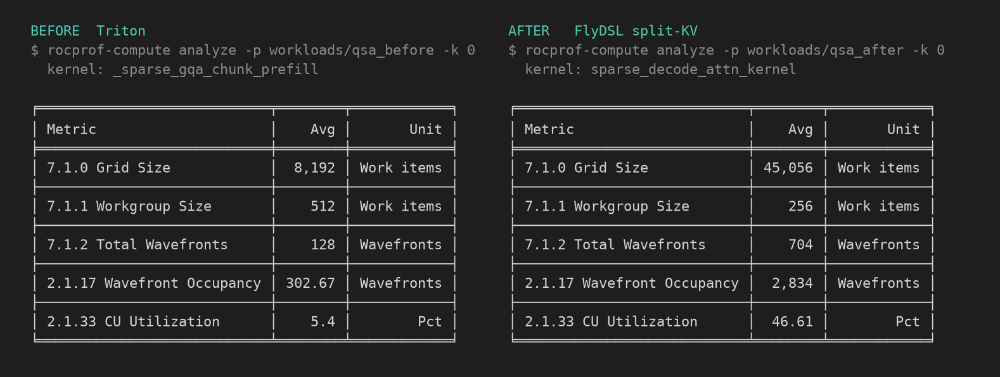
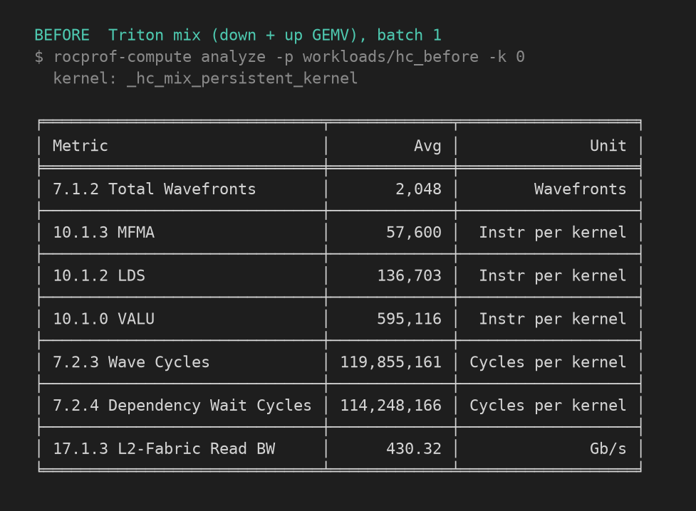
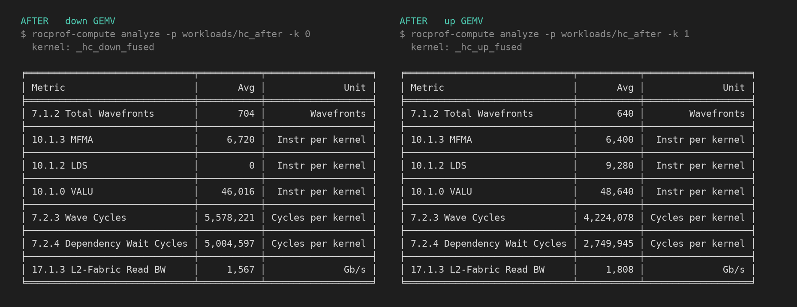
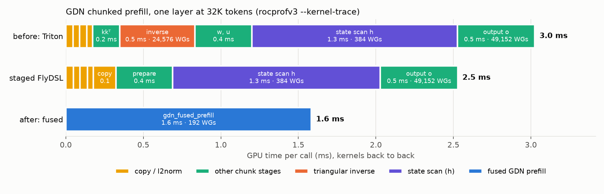

Qwen3.8-Flash-Next is an efficient, open-weight MoE model, previewing the next-generation Qwen4 architecture. It has gained significant attention in the open-source community due to its strong coding and agentic capabilities, ultra-sparse architecture, and innovations such as Gated DeltaNet (GDN) and Qwen Sparse Attention (QSA) for efficient long-context inference. Given these strengths, enabling and optimizing Qwen3.8-Flash-Next inference on AMD Instinct MI355X GPUs is important. In this blog, we demonstrate how to improve its inference performance through a series of optimizations in SGLang on AMD GPUs. We benchmark inference performance using the InferenceX AgentX benchmark, which replays realistic multi-turn agentic coding workloads and measures throughput and interactivity across different concurrency levels. Our optimized MI355X implementation outperforms NVIDIA B200 and B300 GPUs across all tested concurrency levels.

This post explores how we serve and optimize Qwen3.8-Flash-Next on AMD Instinct MI355X GPUs using SGLang. We begin with our latest InferenceX AgentX benchmark results, followed by a brief introduction of the model architecture, key kernel optimizations for MI355X, including grid sizing for 256 CUs, kernel fusion, MFMA-native layouts, register prefetching, and wave64, and the monokernel for low concurrency. All results can be reproduced using the commands provided in the [SGLang cookbook](https://lmsysorg.mintlify.app/cookbook/autoregressive/Qwen/Qwen3.8-Flash-Next#hw=mi355x&variant=default&quant=fp8&strategy=balanced&nodes=single&pleOffload=auto).

## Performance

We use InferenceX AgentX to evaluate inference performance, as InferenceX is a public benchmarking platform that enables fair comparisons across different hardware platforms using standardized workloads and configurations. AgentX provides realistic multi-turn agentic coding workloads that capture long-context requests, prefix caching, and subagent interactions. Its throughput and interactivity metrics allow us to assess serving performance across different concurrency levels, reflecting real-world agentic workloads.

As shown in Figure 1., we ran Qwen3.8-Flash-Next on one MI355X at concurrency 1, 2, 12, 24, 48 and 80 on the SGLang ROCm image lmsysorg/sglang-rocm:v0.5.23-rocm10-mi35x-20261117. Each point replays recorded coding-agent sessions from the InferenceX AgentX trace set for 3,600 s. Throughput per GPU rises from 16.8k to 230.8k tok/s as concurrency grows, while per-user interactivity falls from ~390 to ~27 tok/s/user. At low concurrency the monokernel drives interactivity; at high concurrency kernel fusion and HiCache keep throughput scaling.


*Figure 1. Total throughput per GPU against interactivity across concurrency 1–80.*

At high concurrency (24–80), the workload is dominated by long, largely shared prompts, so prefill speed and cache capacity matter as much as decode speed. Our MI355X run reaches about 126k tokens/s per chip at conc=24 and about 231k at conc=80, matching or exceeding B300 at the same P90 interactivity and staying well above B200 and our previous MI355X results. All of it runs on the public SGLang ROCm image. At low concurrency (1–2), decoding is bound by kernel launches, not arithmetic: one decode step took about 14 ms across more than 1,600 small kernels. Our monokernel, a persistent FlyDSL kernel that runs a full MTP verify step in 13 launches, cuts that to about 4 ms. P90 interactivity reaches about 390 tokens/s/user at one agent, where B300's curve falls off to a few thousand tokens/s per chip. We will give more details about the optimizations in the latter sections.

**NOTE:** Until the day Nov 19, 2026, we wrote the blog and the performance submission shown in the figure depended on 7 PRs that awaited to be merged to the SGLang main branch.

## Qwen3.8-Flash-Next Model Architecture

The model architecture of Qwen3.8-Flash-Next is shown in Figure 2. For its inference, these properties of the model architecture matter:

- **Gated Delta Net.** 36 of the 48 layers use Gated Delta Net, a linear-attention layer with a fixed-size recurrent state per request, so its decode cost does not grow with context.
- **Query Sparse Attention.** The other 12 use Query Sparse Attention: each query attends to a learned selection of past positions, with 24 query heads sharing 2 KV heads of dimension 256.
- **Hyper-connections.** Instead of one residual stream, the model keeps 4 streams of width 2,560. Before every block a gated mix collapses them into one input. It is small but runs in every layer at every step.
- **Native MTP.** A built-in draft layer proposes tokens for speculative decoding, verified by the target in one forward pass.


*Figure 2: Qwen3.8-Flash-Next model architecture*

### The checkpoint: MXFP4 experts with AMD Quark

For AMD Instinct GPUs, we quantized the Qwen3.8-Flash-Next model weights using AMD Quark, a model optimization toolkit that supports post-training quantization for efficient inference on AMD hardware. The resulting quantized model reduces GPU memory consumption and improves inference efficiency. In our experiments, we serve `[amd/Qwen3.8-Flash-Next-Quark-MXFP4-AttnFP8-PLEFP8](https://huggingface.co/amd/Qwen3.8-Flash-Next-Quark-MXFP4-AttnFP8-PLEFP8)`.

The quantized checkpoint occupies approximately 116 GB, fitting comfortably on a single AMD Instinct MI355X GPU (288 GB HBM3E) while leaving enough memory for a large KV cache, enabling higher concurrency and more efficient inference serving. The MTP draft model is quantized using the same approach as the target model, allowing its MoE layers to benefit from the same optimized MXFP4 kernels.

## Kernel Optimization

# Porting NVIDIA kernels to MI355X: what you need to rewrite

A kernel tuned for B300 usually *runs* on MI355X (gfx950). Triton compiles for
ROCm, and CUDA code can be HIPified. But it rarely runs *well*. We saw this
while bringing up Qwen3.8-Flash-Next in SGLang on MI355X. Three parts of the
model needed new kernels, and in all three the math stayed the same. What we
rewrote was how the work is split, how data reaches the matrix cores, and
where the kernel boundaries are. That gave 1.4–5.7× at the kernel level and up
to +15% end-to-end interactivity.

## Where the kernels sit in Qwen3.8-Flash-Next

Qwen3.8-Flash-Next is a hybrid model with 48 layers:

- **36 GDN layers** (Gated DeltaNet linear attention) keep a fixed-size state
  instead of a KV cache. Prefill runs a chunked scan over 64-token chunks.
- **12 QSA layers** (Qwen sparse attention, every fourth layer). An indexer
  picks 512 compressed blocks of 4 tokens plus up to 3 recent tokens, so
  each query attends to only 2,051 positions.
- **Hyper-connections (HC).** The model keeps four residual streams. Around
  every attention and MLP block, an HC site mixes the streams into the block
  input and injects the block output back.

All numbers below are for one MI355X at TP1, with the MXFP4 checkpoint and MTP.
These are the shapes the kernels see:

| Kernel | Shapes at TP1 | What limited it on MI355X |
|---|---|---|
| QSA sparse decode | 24 query heads, 2 KV heads (GQA group 12), head dim 256, top-k 2051 | Grid of rows × 2 KV heads, plus an extra gather pass |
| GDN chunked prefill | 48 value heads, 16 key heads, K = V = 128, 64-token chunks | 8 launches per layer, per-chunk state round trip through HBM |
| HC site, decode | 4 streams × 2560 = K 10240, low rank R 320, M ≤ 128 rows | Norm, mix, inject GEMV and combine as separate small kernels |

| Kernel | NVIDIA path in SGLang | Rewrite for MI355X | Kernel gain | End to end (MI355X, TP1) |
|---|---|---|---|---|
| QSA sparse decode ([sglang#45196](https://github.com/sgl-project/sglang/pull/45196), [aiter#6670](https://github.com/ROCm/aiter/pull/6670)) | Triton KV gather + FlashInfer TRT-LLM decode | One fused FlyDSL kernel with split-KV | 120 → 33 µs/call (3.4–5.7×) | +12.7% p50 interactivity, −11% ITL |
| GDN chunked prefill ([sglang#44103](https://github.com/sgl-project/sglang/pull/44103), [aiter#6496](https://github.com/ROCm/aiter/pull/6496)) | FlashInfer CuTe DSL chunk kernel | One fused kernel, state kept on chip | 1.6× vs best multi-kernel path, 2.2× vs Triton | up to +3.6% throughput, −8.7% TTFT p95 |
| HC site, decode ([sglang#48648](https://github.com/sgl-project/sglang/pull/48648)) | CuTe DSL split-K GEMM + separate norm/combine | Norm and inject fused into the mix | 3.0× at M=1, 1.4× at M=128 | +14.9% P90 interactivity, +5.6% throughput |

The code below is taken from these PRs. Lines marked `...` are left out.

## 1. Kernel shape: QSA sparse decode did not fit the GPU

MI355X has **256 CUs**. A kernel is fast only if it gives every CU work for
about the same time. The QSA decode kernel we started from was shaped by the
problem, not by the GPU, and at decode the problem is small.

### What the kernel computes

At decode, each **row** is one query token: the next token of a request, or
one MTP draft token being verified. For one row at TP1:

```
Q          24 query heads × 256 (head dim)
           ├─ q heads  0..11 ──► KV head 0     GQA: 12 query heads
           └─ q heads 12..23 ──► KV head 1          share one KV head

K, V       per KV head: 2,051 selected positions × 256
           (indexer: 512 blocks × 4 tokens + up to 3 recent tokens)

output     24 × 256
```

So the kernel has three dimensions: **rows** (1 to 128 at decode), **KV
heads** (only 2) and **positions** (2,051). Where each one goes, into the
grid, the workgroup, the tile or the loop, decides how fast the kernel is.

### Before: a prefill kernel reused for decode

The ROCm path ran the Triton kernel `_sparse_gqa_chunk_prefill`, a sparse
*prefill* kernel, with a query length of 1. At batch 8 its shape is:

| Level | Before (Triton) | Where it comes from |
|---|---|---|
| Grid | 1 × (rows × KV heads) = **16 workgroups** | one workgroup per (row, KV head); the first grid dimension is the query tile, always 1 at decode |
| Workgroup | **8 waves** (512 threads) | config table `_L20_CONFIGS`: up to 32 rows → 32 tokens per step, 8 warps, 2 stages |
| Tile | **16 rows × 32 tokens** | the 12 heads of a GQA group padded to 16 rows |
| Loop | 2,051 / 32 = **65 steps** per workgroup | all positions of one (row, KV head) are walked by one workgroup |

```
grid = 8 rows × 2 KV heads = 16 workgroups of 512 threads

                 positions 0 ─────────────────────────────────────► 2050
row 0, kv 0    [ WG: 65 steps × 32 tokens, one after another          ]
row 0, kv 1    [ WG: 65 steps × 32 tokens                             ]
   ...
row 7, kv 1    [ WG: 65 steps × 32 tokens                             ]

┌────────────────────────────────┐
│■■■■■■■■■■■■■■■■□□□□□□□□□□□□□□□□│   ■ busy CU   □ idle CU
│□□□□□□□□□□□□□□□□□□□□□□□□□□□□□□□□│   16 of 256 CUs work; each streams
│   ... 8 rows × 32 = 256 CUs     │   2.1 MB of K/V through one CU
└────────────────────────────────┘
```

Three things are wrong with this shape:

1. **The grid is set by the problem, not by the GPU.** rows × KV heads is
   tiny at decode, and Qwen3.8 has only 2 KV heads: a model with 8 KV heads
   would get 4× more workgroups from the same rows. At batch 1 the kernel
   launches 2 workgroups on 256 CUs.
2. **The only large dimension is a loop.** The 2,051 positions are walked
   inside one workgroup, 32 at a time. The kernel takes as long as one
   workgroup needs for 65 steps, however many rows there are.
3. **The workgroup and tile were sized for another GPU.** The table is
   picked by device name: `_H20_CONFIGS` if the name contains "H20", else
   `_L20_CONFIGS`. On MI355X it is always the L20 table. It gives 8 waves to a
   tile that is only 16 rows tall, a single MFMA tile, so the waves cannot
   split the rows. In fact all 8 compute the same score tile; part 2 shows
   the same mistake in the HC kernel.

### After: the grid is computed from the CU count (split-KV)

The new FlyDSL kernel moves part of the position loop into the grid. Each
row's 2,051 positions are cut into `num_splits` pieces, and each piece gets
its own workgroup. A workgroup cannot write the final output, because it sees
only part of the softmax, so it writes a partial result per head (the
unnormalized output `O`, its max score `m` and its sum `l`). A small reduce
kernel then merges the partials the same way online softmax merges blocks.

| Level | After (FlyDSL) |
|---|---|
| Grid | rows × KV heads × `num_splits` = 8 × 2 × 11 = **176 workgroups** |
| Workgroup | **4 waves** (256 threads) |
| Tile | each wave: **16 tokens × 16 heads** (12 + 4 padding), one 16 × 16 × 32 MFMA tile |
| Loop | 192 positions per split = **3 rounds** of 4 waves × 16 tokens |

```
grid = 8 rows × 2 KV heads × 11 splits = 176 workgroups of 256 threads

                 split 0    split 1    split 2          split 10
                 0..191     192..383   384..575   ...   1920..2050
row 0, kv 0    [  WG    ][  WG     ][  WG     ]  ...  [  WG     ]  ──► 11 partials
   ...
row 7, kv 1    [  WG    ][  WG     ][  WG     ]  ...  [  WG     ]  ──► 11 partials

inside one workgroup (one split = 3 rounds):

            wave 0     wave 1     wave 2     wave 3
round 0   [ 0..15  ] [ 16..31 ] [ 32..47 ] [ 48..63  ]
round 1   [ 64..79 ] [ 80..95 ] [ 96..111] [112..127 ]
round 2   [128..143] [144..159] [160..175] [176..191 ]
```

Tokens now sit on the 16-row side of the tile, so each wave owns its own 16
tokens and no wave repeats another's work.

`num_splits` is computed at run time with three rules:

| Rule | Why |
|---|---|
| aim for one workgroup per CU | more workgroups than CUs does not help: each extra split adds a prologue and one more partial to merge |
| at least 128 positions per split | that is 2 tiles per wave; below it, the fixed cost of starting a workgroup is larger than the gain |
| round each split up to whole 64-position rounds | a partial round would leave waves idle |

What that gives at each batch size, with the CU utilization of the attention
kernel measured by rocprof-compute (metric 2.1.33). Batch size here is the
number of decode rows, one query token per request:

| Batch size | `num_splits` | Positions per split | Workgroups before → after | CU Utilization before → after |
|---:|---:|---:|---:|---:|
| 1 | 17 | 128 | 2 → 34 | 0.7% → 7.9% |
| 2 | 17 | 128 | 4 → 68 | 1.4% → 15.2% |
| 4 | 17 | 128 | 8 → 136 | 2.7% → 31.9% |
| 8 | 11 | 192 | 16 → 176 | 5.4% → 45.7% |
| 16 | 7 | 320 | 32 → 224 | 10.8% → 59.4% |
| 32 | 4 | 576 | 64 → 256 | 20.7% → 71.1% |
| 64 | 2 | 1,088 | 128 → 256 | 41.2% → 78.3% |
| 128 | 1 | all 2,051 | 256 → 256 | 88.5% → 84.1% |

At batch 128 the old grid already fills the GPU, so nothing is split, the
reduce kernel is skipped, and the CU utilization is the same as before. The
new kernel is still 1.4× faster there: its waves no longer repeat each
other's work, and it reads the selected K/V straight from the cache pool
instead of from a copy that a separate gather kernel made. The split count
depends only on the batch size, so it is fixed for each captured CUDA graph.

### rocprof: before and after

**The attention kernel, batch 8 at 32K context** (rocprof-compute blocks 2
and 7):



Before: 8,192 work items in workgroups of 512, so 16 workgroups and 128
wavefronts. On average only 303 of the GPU's 8,192 wave slots are in use, and
**CU Utilization is 5.4%**. After: 45,056 work items in workgroups of 256, so
176 workgroups and 704 wavefronts, 2,834 wave slots in use, **CU Utilization
46.6%**.

**The same kernel at batch sizes 1 to 128.**


Before, CU utilization simply follows the workgroup count: 2 workgroups give
0.7%, 16 give 5.4%, and the GPU is only filled at batch 128, where the grid
reaches 256 workgroups. Most real decode batches are far below that. After,
the grid is sized to the GPU at every batch: 46% at batch 8 and over 70% from
batch 32 on. At batch 1 it is still only 8%, because the 128-position minimum
per split caps the grid at 34 workgroups.

### Takeaway

At decode, the problem shape (rows × heads) is far smaller than 256 CUs, and
few KV heads make it smaller still. Compute the grid from the CU count at run
time, move part of the long loop into the grid, and size the workgroup and
the tile for MFMA instead of inheriting a config table from another GPU. In
rocprof, check **Grid Size** and **CU Utilization**, and measure them at the
batch sizes you actually serve, not only at the largest one: a grid that
fills the GPU only at batch 128 leaves it mostly idle at batch 8.

## 2. MMA: the HC mix issued 4.5× too many MFMAs ([sglang#48648](https://github.com/sgl-project/sglang/pull/48648))

Around every block, a hyper-connection (HC) site mixes the model's four
residual streams (4 × 2,560 = 10,240 values per row) into the block's input
with two GEMVs: **down** to 320 values, then **up** back to 10,240. At batch 1
that is about 13 MB of weights and almost no math, done on MFMA with the
single row padded to a 16-row tile. On ROCm both GEMVs ran in one generic
Triton kernel, `_hc_mix_persistent_kernel`.
[sglang#48648](https://github.com/sgl-project/sglang/pull/48648) replaces it
with FlyDSL kernels built for MFMA.

### Why the old kernel issued so many MFMAs

Triton turns each matrix product (`tl.dot`) into MFMAs and hands the 16 × 16
output tiles to the waves of the workgroup. It does not split the `k`
dimension between waves, so a product can keep at most as many waves busy as
its output has 16 × 16 tiles. Any extra wave gets a copy of a tile that
another wave already computes.

The old kernel runs both GEMVs in one persistent launch, so it has one wave
count for both: **8 waves** per workgroup. That fits the up GEMV and not the
down GEMV:

```
up GEMV    output per step: 16 rows × 128   = 8 MFMA tiles
           wave 0 │ wave 1 │ wave 2 │ ... │ wave 7        8 waves, 8 different tiles   ✓

down GEMV  output per tile: 16 rows × 32    = 2 MFMA tiles
           waves 0–7 are laid along the 16 rows (warpsPerCTA = [8, 1]),
           and 16 rows are one tile:  every wave computes both tiles     8 copies   ✗
```

Each down tile (k = 256) needs 2 × 8 = 16 MFMAs; with 8 copies it issues 128.
Over the 400 down tiles that is 51,200 MFMAs instead of 6,400. With the up
GEMV (6,400, no copies), the kernel issues **57,600 MFMAs where 12,800 are
needed**. That is exactly the count rocprof-compute reports:



### Why that is bad

The matrix cores do not mind: MFMA utilization is under 1%, before and after.
A batch-1 GEMV is limited by memory. The cost of the copies is in the waves:

- **Every copy needs its own operands.** The weights are row-major, so each
  tile is loaded from HBM, written to LDS and read back in the MFMA layout,
  and each of the 8 waves reads the whole tile back for its own copy. Most of
  the 136,703 LDS instructions are those repeated reads.
- **The waves wait instead of loading.** The kernel spends 120 M wave-cycles
  per site, and 114 M of them (95%) waiting for a dependency: an LDS read, an
  MFMA result, or a load. The 8 waves of a workgroup move one tile at the
  pace of all that repeated work, and the weights arrive at **430 GB/s** on a
  GPU with 8 TB/s.

```
per down tile:   HBM ──► registers ──► LDS ──► 8 × (LDS read ──► 16 MFMAs)   → same result 8 times
```

### How we reduced it

The PR gives every wave its own tile, and lets each wave load its operand
directly:

- **One kernel per GEMV, each with its own wave shape.** The down GEMV runs
  on 704 one-wave workgroups: 22 row tiles × 32 splits of `k`. The `k`
  dimension is split across workgroups instead of copied across waves, and a
  small reduce kernel adds the 32 partial sums. The up GEMV runs on 640 waves,
  one 16-column tile each.
- **Weights in MFMA fragment order.** Once, at load time, each 16 × 32 weight
  fragment is packed into one contiguous 1 KB block, lane by lane. One
  16-byte load per lane then *is* the MFMA operand, straight from HBM into
  registers: no LDS in the down GEMV, and each wave has its 10 fragments in
  flight before its first MFMA.
- **The rest of the site rides along.** The per-stream RMSNorm is folded into
  the packed weights and the reduce, and the combine's inject GEMV is one more
  row tile of the down GEMV (the 21st; the 22nd computes the norm statistics).

```
packed weights:  [ tile ][ k-step ][ lane 0: 16 B | lane 1: 16 B | ... | lane 63: 16 B ]  = 1 KB

down:  22 tiles × 32 k-splits × 10 k-steps = 6,720 MFMAs, one wave each, no LDS
up:    640 tiles × 10 k-steps              = 6,400 MFMAs
```

### Result



| per HC site, batch 1 | Before | After (down + up) |
|---|---:|---:|
| MFMA instructions | 57,600 | **13,120** (12,800 + 320 for the inject GEMV) |
| LDS instructions | 136,703 | **0** + 9,280 |
| Wave cycles | 120 M | **9.9 M** |
| Weight read bandwidth | 0.43 TB/s | **1.6–1.8 TB/s** |


The whole site drops from 43.5 to **16.0 µs** at batch 1. It is still 4
kernels, but the 31.8 µs mix is now three small kernels, and the separate
norm and inject GEMV are gone. The PR measures 3.0× per site at M = 1 down to
1.4× at M = 128, and **+14.9% P90 interactivity, +5.6% throughput** end to end.

**Takeaway:** a matrix product can only keep as many waves busy as it has
16 × 16 output tiles. Size the waves per product, not per kernel, and split
`k` across workgroups when one tile is all there is. In rocprof, compare the
MFMA count with one MFMA per tile and `k` step: a multiple of the wave count
means the waves are computing copies.

## 3. Memory: GDN prefill moved its intermediates through HBM

### What the kernel computes

A GDN layer keeps a 128 × 128 state per value head instead of a KV cache. In
prefill, the tokens are cut into chunks of 64 (512 chunks at 32K tokens), and
for every chunk and head:

```
1. normalize q, k
2. A    = masked, decayed β·k·kᵀ                     64 × 64
3. T    = (I + A)⁻¹                                  64 × 64
4. w, u = from T, k, v                               64 × 128
5. S    = new state from the old S, w, u, k          128 × 128   ◄── needs the previous chunk
6. o    = output from q, k, S, u                     64 × 128
```

Only the inputs (q, k, v and the gates) and the output o have to touch HBM.
At 32K tokens that is about 0.7 GB to read and 0.4 GB to write per layer.
Everything else is an intermediate.

### Before: one kernel per stage

The Triton path runs 9 kernels per layer: a copy and an l2norm for q and for
k (step 1), then one kernel each for steps 2, 3, 4, 5 and 6. Each kernel
works on all 512 chunks and writes its whole result to HBM, and the next
kernel reads it back.

The worst of these is the state:

- The state scan (step 5) has to walk the chunks in order. It runs on only 384
  workgroups, and it writes the state of **every** chunk to HBM, so that the
  output kernel (step 6) can read them back. With the corrected values it
  also hands to step 6, it writes 1.2 GB (the 512 chunk states alone are
  0.8 GB) and reads 6.2 GB.
- Every kernel starts cold. A load from HBM takes many hundreds of cycles,
  and with one stage per kernel there is little other work in the same
  kernel to hide it behind.

Measured per kernel with rocprof-compute (block 17, bandwidth × kernel time):

| Kernel | Step | Time | Read | Written |
|---|---|---:|---:|---:|
| l2norm (× 2) | 1 | 2 × 0.04 ms | 0.3 GB | 0.3 GB |
| kkᵀ | 2 | 0.17 ms | 0.3 GB | 0.4 GB |
| inverse | 3 | 0.50 ms | 0.3 GB | 0.2 GB |
| w, u | 4 | 0.37 ms | 1.1 GB | 0.8 GB |
| state scan h | 5 | 1.34 ms | 6.2 GB | 1.2 GB |
| output o | 6 | 0.47 ms | 2.8 GB | 0.4 GB |
| **total** | | | **11.0 GB** | **3.3 GB** |

(The two copy kernels are not counted.)

### After: one kernel, intermediates on chip

The fused FlyDSL kernel runs all six steps for all chunks in one launch:

- **192 workgroups of 8 waves.** Each owns one head and a 32-column slice of
  its state (48 heads × 4 slices) and walks the chunks of its sequence in
  order.
- **The state stays in registers** for the whole sequence and is written to
  HBM once, at the end. `A`, `T`, `w`, `u` live in registers and LDS (91 KB
  per workgroup) and never reach HBM. Per chunk, only the output o is
  written.
- **The next inputs are already on the way.** While a workgroup computes
  chunk `ch`, the loads for chunk `ch + 2` are in flight into registers, so
  almost two chunk steps of compute hide each load. The registers are reused:
  the loads are issued only after chunk `ch`'s inputs have been stored to
  LDS.
- **The end of a sequence costs nothing.** The last chunk usually runs past
  the end of its sequence. The output's buffer descriptor ends at the
  sequence end, so the hardware drops the stores past it, with no masks.

```
before:  q,k ─► [l2norm] ─HBM─► [kkᵀ] ─HBM─► [inverse] ─HBM─► [w,u] ─HBM─► [state scan] ─HBM─► [output] ─► o
                                                                           (all 512 states)

after:   q,k,v ─► [ one kernel: per chunk, steps 1–6 in registers / LDS,
                    state in registers, next inputs prefetched 2 chunks ahead ] ─► o, final state
```

### rocprof: before and after

**One layer at 32K tokens** (kernel trace):



Triton: 9 kernels, 3.0 ms; the state scan alone is 1.3 ms. The staged FlyDSL
path (faster stages, but still 8 kernels that pass their results through HBM)
gets to 2.5 ms. Fused: 1 kernel, 1.6 ms.

**Data moved per layer, per kernel** (rocprof-compute block 17):


Before: **14.3 GB** per layer, 11.0 GB read and 3.3 GB written, most of it
intermediates. The state scan is the biggest part: 6.2 GB read and 1.2 GB
written. After: **3.5 GB**. The fused kernel
writes **0.4 GB, which is exactly the output o** (32K tokens × 48 heads × 128
× 2 bytes = 0.40 GB): nothing else leaves the chip. It reads 3.1 GB, still
above the 0.7 GB minimum, because q and k are read again by every workgroup
that needs them (4 state slices per head, 3 value heads per key head); part
of that is served by the caches.

### Takeaway

Count the bytes, not only the FLOPs. Split into stages, a chunked algorithm
writes every intermediate to HBM and reads it back. When the stages share a
serial loop anyway, as GDN's chunks do, run them in one kernel, keep the
state and the intermediates on chip, and issue the next chunk's loads early.
In rocprof-compute, multiply the L2-Fabric bandwidth by the kernel time and
compare it with the inputs and outputs the math really needs: the writes in
particular should be close to the size of the output.

## Summary

| Part | Kernel | Problem | How it shows in rocprof | Fix | Result |
|---|---|---|---|---|---|
| 1. Shape | QSA sparse decode | grid = rows × 2 KV heads, positions in a loop | 16 workgroups, CU Utilization 5.4% at batch 8 | split-KV: grid from the CU count | 46% CU utilization; 92 → 21 µs per call |
| 2. MMA | HC site | 8 waves on one 16-row tile; weights through LDS | 57,600 MFMAs, 136,703 LDS instructions | one wave per tile; weights packed in fragment order | 13,120 MFMAs, no LDS in the down GEMV; 43.5 → 16.0 µs per site |
| 3. Memory | GDN prefill | 9 kernels pass intermediates through HBM | 14.3 GB per layer, 3.3 GB written | one kernel; state and intermediates on chip; prefetch | 3.5 GB, 0.4 GB written (= the output); 3.0 → 1.6 ms per layer |

The math of these kernels did not change. What changed was how the work is
split across the GPU, how it reaches the matrix cores, and how much of it goes
through HBM. That gave 1.9–4.4× at the kernel level in these measurements and
up to +15% end-to-end interactivity.

## Appendix: reproducing the screens

Each driver calls the before and the after path of one PR at the shapes
above:

- **QSA** (from sglang#45196's `bench_qsa_sparse_decode.py`):
  `qsa_driver.py --impl gather_triton|fused_flydsl --batch 8` (and
  `--batch 1 2 4 16 32 64 128` for the batch chart)
- **HC** (from sglang#48648's `test_hc_fused_flydsl.py`, 16 different layers in
  turn so the weights are not cache-hot): `hc_driver.py --impl unfused|fused --rows 1`
- **GDN** (from aiter#6496's `bench_gdn_fused_prefill.py`):
  `gdn_driver.py --impl triton|flydsl|fused` (H 48, Hg 16, T 32768, N 1)

**Kernel trace:**

```bash
rocprofv3 --kernel-trace -T -f csv pftrace -d prof/gdn_triton -o run -- \
    python gdn_driver.py --impl triton
```

**Counters** (rocprof-compute needs `pip install -r
/opt/rocm/libexec/rocprofiler-compute/requirements.txt`; with pandas 3,
version 3.4.0 cannot parse the rocprofv3 output, so use `pandas<3`):

```bash
rocprof-compute profile -n qsa_before --no-roof -k _sparse_gqa_chunk_prefill \
    --path workloads/qsa_before -- python qsa_driver.py --impl gather_triton --iters 5
rocprof-compute analyze -p workloads/qsa_before -b 0            # kernel list, -k index
rocprof-compute analyze -p workloads/qsa_before -k 0 -b 2 7     # shape

# CU utilization only, one batch size per run (the batch chart):
rocprof-compute profile -n cu_before_b16 --no-roof -b 2.1.33 7.1.0 -k _sparse_gqa_chunk_prefill \
    --path workloads/cu_before_b16 -- python qsa_driver.py --impl gather_triton --batch 16

rocprof-compute profile -n hc_after --no-roof -k _hc_down_fused _hc_reduce_fused _hc_up_fused \
    _hc_inject_fused --path workloads/hc_after -- python hc_driver.py --impl fused --iters 16
rocprof-compute analyze -p workloads/hc_after -k 0 -b 7 10 17   # MFMA, LDS, bandwidth

rocprof-compute profile -n gdn_after --no-roof -k gdn_fused_prefill \
    --path workloads/gdn_after -- python gdn_driver.py --impl fused --iters 2
rocprof-compute analyze -p workloads/gdn_after -k 0 -b 17       # L2 and fabric
```

| Image | Source | Kernel(s) |
|---|---|---|
| `shape_qsa_counters.png` | rocprof-compute blocks 2, 7 | QSA attention kernel |
| `shape_qsa_batch.png` | rocprof-compute 2.1.33 at 1, 2, 4 … 128 rows | QSA attention kernel |
| `mma_hc_before.png` | rocprof-compute blocks 7, 10, 17 | HC Triton mix |
| `mma_hc_after.png` | rocprof-compute blocks 7, 10, 17 | HC fused down and up GEMVs |
| `mma_hc_trace.png` | kernel trace | one HC site |
| `mem_gdn_trace.png` | kernel trace | one GDN layer, 3 paths |
| `mem_gdn_traffic.png` | rocprof-compute block 17 | all GDN kernels |

### Monokernel

When we first benchmarked this model on AMD MI355X we quickly realized that the low concurrency region (i.e., <= 8) was going to be the most critical for us in terms of performance.


*Figure 3: Kernel trace of a full decode step at concurrency 1 without monokernel*

Figure 3 shows the full trace of one decode step at concurrency 1. As you can see, it takes roughly 14ms for a total of over **1600 individual kernel launches**.
Launching a lot of kernels is not necessarily a problem as HIP graphs can get rid of kernel launch overheads but in this case it actually is. The issues is that these kernels are all very small so the GPU is not doing useful work but mostly loading data from and to HBM memory. In this scenario, the most practical optimization strategy is simply trying to reduce as much as possible the HBM traffic, this means fusing multiple operations together.

In order to achieve the best possible performance at low concurrency, we decided to fuse as many kernels as possible into a single (mono) kernel.
As we saw in figure 2, the basic building block for Qwen3.8-Flash-Next is 3x GDN layers followed by a QSA layer, repeated 12 times for a total of 48 hidden layers. We implemented a specialized FlyDSL kernel that replaces this basic building block with a **single kernel launch**.


*Figure 4: Kernel trace of a full decode step at concurrency 1 with the new FlyDSL monokernel*

Figure 4 shows a full decode step with the monokernel on. With this we got rid of over 1600 kernel launches and replaced them with just **13** and went from almost **14ms to 4ms**, that's over **3x improvement** in decode speed.

For more details, the monokernel source code is available on [GitHub](https://github.com/sgl-project/sgl-amd-mono/tree/main/sgl_amd_mono/qwen38_flash_next).

## Conclusion

With a Quark MXFP4 checkpoint that fits on a single MI355X and a set of MI355X-specific kernels in SGLang, Qwen3.8-Flash-Next reaches about 231k tokens/s per GPU at concurrency 80 and about 390 tokens/s/user at concurrency 1 on InferenceX AgentX, matching or exceeding B300 and staying well above B200 across the range we tested. Two kinds of change made the difference. Rewriting the NVIDIA-oriented kernels around the MI355X (a grid sized for 256 CUs, MFMA-native layouts, and intermediates kept on chip) improves the high-concurrency regime. At low concurrency, the FlyDSL monokernel replaces more than 1,600 launches per decode step with 13 and cuts the step from about 14 ms to 4 ms. The kernel changes are pull requests to SGLang and AITER, and the monokernel is open source in `sgl-amd-mono`, so you can reproduce the results with the SGLang cookbook and try them on your own workloads.

## Acknowledgements

We thank the Qwen team, the SGLang community, and the AMD AITER, FlyDSL, Quark, ROCm and InferenceX contributors whose work this post builds on. [TODO: names.]

## Test configuration and disclaimer

**Software stack of the recipes above:** `lmsysorg/sglang-rocm:v0.5.23-rocm10-mi35x-20261117` (SGLang `c67db7c762`, AITER `581579ab`, FlyDSL 0.4.2), patched with the open PRs listed above. **Numbers in Performance and Accuracy** were measured on one GPU of an 8x AMD Instinct MI355X node in October 2026 with `lmsysorg/sglang-rocm:v0.5.22-rocm10-mi35x-20261026` (SGLang `5ef99013`, AITER `285579b6`), patched with the PRs open at the time, through the InferenceX AgentX agentic-coding harness (AIPerf replay of recorded coding-agent traces, 3,600 s per point, InferenceX run [40420614823](https://github.com/SemiAnalysisAI/InferenceX/actions/runs/40420614823)). Per-PR numbers quoted in the optimization sections come from each pull request's own benchmarks, on the base and image given there. Speculative-decoding throughput uses InferenceX's committed synthetic acceptance length; accuracy uses lm-eval with real verification. Results on other hardware, software versions, settings or workloads will differ; these figures are for illustration and are not a performance guarantee.

#### Article by

Authors: Nikolai (@amd-nprotaso), Christian Gilli (@amd-cgilli), and Chang Liu (@ChangLiu0709) — AMD.
